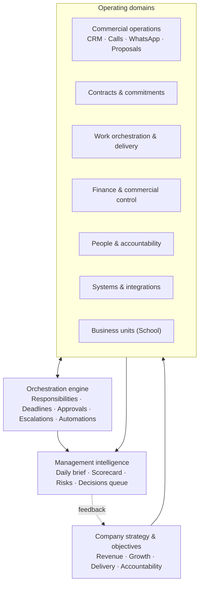
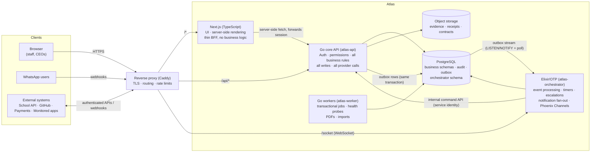
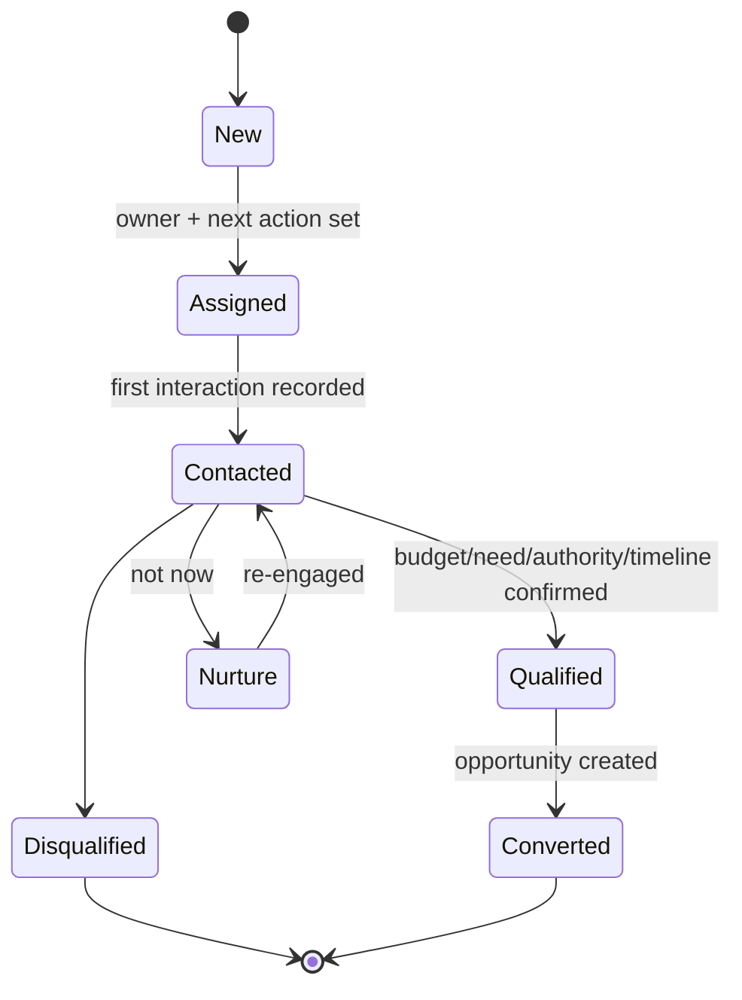
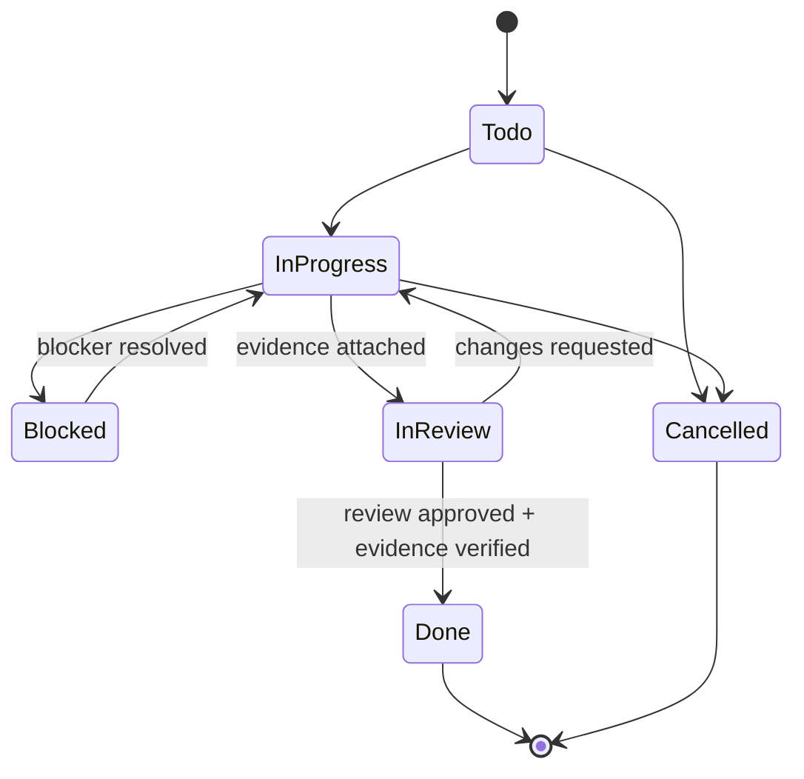
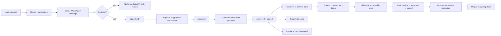
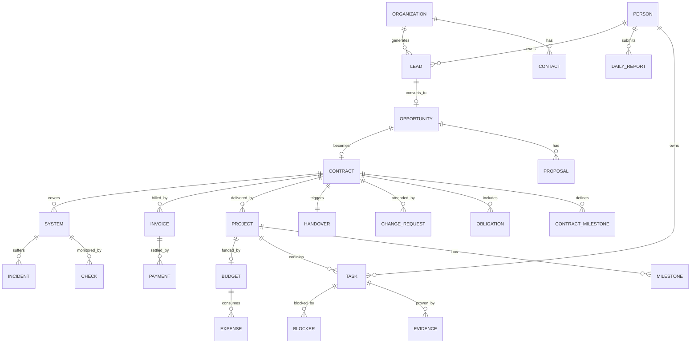

# Project Atlas — The SafariStack Company Operating System

> **Atlas** is the internal operating system of SafariStack Solutions: the single place where strategy becomes work, work becomes evidence, and evidence becomes decisions.

| | |
|---|---|
| **Document** | Atlas Blueprint — architecture, modules, data, workflows, roadmap |
| **Version** | 0.1 (founding draft) |
| **Date** | 11 October 2026 |
| **Owners** | Internal & Technical CEO (author) · Commercial CEO (co-owner) |
| **Status** | Draft for joint CEO review |
| **Stack** | Next.js + TypeScript · Go · Elixir/OTP · PostgreSQL |

---

## Table of contents

0. [How to use this document](#0-how-to-use-this-document)
1. [Vision and thesis](#1-vision-and-thesis)
2. [Design principles](#2-design-principles)
3. [Organisation model: two CEOs, one company](#3-organisation-model-two-ceos-one-company)
4. [Capability map](#4-capability-map)
5. [System architecture](#5-system-architecture)
6. [Platform foundation](#6-platform-foundation)
7. [Event model](#7-event-model)
8. [Module specifications](#8-module-specifications)
9. [Cross-module workflows](#9-cross-module-workflows)
10. [Data architecture](#10-data-architecture)
11. [API standards](#11-api-standards)
12. [Integrations](#12-integrations)
13. [Security, privacy and compliance](#13-security-privacy-and-compliance)
14. [Observability and reliability](#14-observability-and-reliability)
15. [Repository structure](#15-repository-structure)
16. [Engineering workflow, environments and deployment](#16-engineering-workflow-environments-and-deployment)
17. [Roadmap and phase exit criteria](#17-roadmap-and-phase-exit-criteria)
18. [Company scorecard](#18-company-scorecard)
19. [Architecture decision records](#19-architecture-decision-records)
20. [Risks](#20-risks)
21. [Open decisions](#21-open-decisions)
22. [Glossary](#22-glossary)
23. [Appendix A — Phase 0 and Phase 1 backlog](#appendix-a--phase-0-and-phase-1-backlog)

---

## 0. How to use this document

- This is the **founding blueprint**. It is the reference for what Atlas is, how it is built, and in which order.
- Anything marked **[DECIDE]** is an open decision that must be resolved (and recorded as an ADR) before the phase that needs it.
- Anything marked **[CONFIG]** is a value the business sets inside Atlas (thresholds, times, limits) — not something hard-coded.
- Endpoints, events and tables in this document are **proposed contracts**, not existing implementations.
- When this document and the code disagree, the code is wrong or this document must be updated through an ADR. Never let them drift silently.

---

## 1. Vision and thesis

### 1.1 The thesis

**Your system determines your business.** A company's strategy is only real if it shows up in how work is assigned, how decisions are made, how people are held accountable, and how results are measured. If those things live in WhatsApp threads, memory and spreadsheets, the strategy is a wish.

Atlas turns SafariStack's strategy into the mechanics of the company:

| Strategy says… | Atlas makes it real by… |
|---|---|
| "We grow through qualified clients" | Every lead has an owner, a next action and a deadline; missed follow-ups escalate |
| "We deliver on time and to spec" | Every task has an owner, a due date and required evidence of completion |
| "We are profitable, not just busy" | Every contract links to a budget, every expense to a project, every invoice to a payment |
| "We are accountable" | Every staff member reports daily against assigned work; blockers reach management automatically |
| "Our systems are reliable" | Every company system is registered, monitored and has an owner and incident history |
| "Management decides on evidence" | A daily executive brief and a decisions queue built from records, not anecdotes |

### 1.2 What Atlas is not

- **Not a generic ERP.** Atlas models how *SafariStack* operates. Generality is added only when a real second use appears.
- **Not a chat app.** WhatsApp and calls are channels into structured records, not where the truth lives.
- **Not a replacement for systems that already work.** The school management system stays the system of record for the school; Atlas integrates with it.
- **Not a product (yet).** Atlas runs SafariStack first. Productising it (e.g. towards Jenga Systems) is a later, separate decision.

### 1.3 Success definition

Atlas is successful when:

1. Both CEOs can answer "what is happening, what needs attention, who is responsible, are we on track?" in under five minutes, from Atlas alone.
2. No signed deal, assigned task, expense or incident exists only outside Atlas.
3. The weekly management meeting is run from Atlas dashboards.
4. Company metrics (Section 18) are computed by Atlas, not compiled by hand.

---

## 2. Design principles

1. **One record, many views.** Each business fact is stored once. Modules share records (client, contract, project, person) rather than copying them.
2. **Events connect modules.** A signed contract emits an event; project creation, budget allocation and invoice scheduling react to it. No one re-types the deal.
3. **Go owns the truth; Elixir owns time and motion.** Go is the only writer of business data and the only caller of external providers. Elixir decides *when* things happen (reminders, escalations, live updates) and asks Go to do them. (Detail in §5.2.)
4. **Accountability is structural.** Every actionable record has exactly one accountable owner, a status, and — where relevant — a due date.
5. **Done means evidenced.** Completion of significant work requires linked evidence: a merged PR, a document, a test result, a client sign-off.
6. **Permissions live in the backend, not the UI.** Hiding a button is cosmetic. Every rule is enforced in Go.
7. **Everything important is audited.** Who changed what, when, from where, and why — append-only.
8. **API-first and contract-first.** Every capability is an authenticated, versioned API (OpenAPI) or a versioned event before it is a screen.
9. **Modular monolith first.** One Go deployable with strict internal module boundaries; split only when evidence demands it.
10. **Configure policy, don't hard-code it.** Approval limits, report times, escalation windows and SLAs are data.
11. **Minimise personal data.** Store what is necessary and authorised, especially for calls, messages and school data.
12. **Dogfood relentlessly.** Every phase ends with SafariStack actually operating through what was built.

---

## 3. Organisation model: two CEOs, one company

### 3.1 Leadership domains

| Domain | Lead | Scope in Atlas |
|---|---|---|
| **Commercial** | Commercial CEO | Leads, pipeline, calls/WhatsApp, proposals, negotiations, contracts (pre-signature), client relationships, client follow-ups |
| **Internal & Technical** | Internal & Technical CEO | Staff, assignments, projects, engineering delivery, code review, system reliability, internal operations, HR |
| **Shared** | Both CEOs | Major expenditure, pricing exceptions, hiring/termination, company performance, cross-functional blockers, strategy, business-unit oversight |
| **Execution** | Staff & project teams | Assigned tasks, deliverables, daily reports, expenses, evidence |

The division is enforced through **permissions, approval routing, dashboards and escalation rules** — not just labels.

### 3.2 Roles (initial)

| Role key | Description |
|---|---|
| `ceo_commercial` | Commercial CEO. Full CRM/contracts; finance read; approvals per matrix |
| `ceo_internal` | Internal & Technical CEO. Full work/people/systems; finance read; approvals per matrix |
| `finance_officer` | Records expenses, invoices, payments; cannot approve own entries |
| `sales_rep` | Leads and interactions they own or are assigned |
| `project_lead` | Manages assigned projects, tasks, reviews, project-level expenses |
| `engineer` | Assigned tasks, reviews, daily reports, own expenses |
| `staff` | Generic staff: assigned tasks, daily reports, leave, own expenses |
| `unit_manager` | Business-unit (e.g. school) manager: unit-scoped views only |
| `auditor` | Read-only access to audit log and finance (external accountant, optional) |
| `system_admin` | Technical administration (users, integrations, settings). Not a business-approval role |

A person can hold several roles. Roles grant **permissions** (§6.2) within a **scope** (company, business unit, department, project, own).

### 3.3 Approval matrix **[CONFIG]**

Thresholds are stored in the `approval_policies` table and editable only with joint CEO approval. The starting values are decided: **D4 → [ADR-016](adr/ADR-016-escalation-windows-and-approval-thresholds.md)** (T1 = KES 10,000; T2 = KES 100,000; D1 = 10%; C2 = KES 500,000). The tier shape is:

| Decision | Below T1 | T1 – T2 | Above T2 |
|---|---|---|---|
| Staff expense | Project lead or line manager | Domain CEO | Both CEOs |
| Purchase / subscription | Domain CEO | Domain CEO | Both CEOs |
| Proposal discount | Commercial CEO (≤ D1 %) | Commercial CEO + Internal CEO informed | Both CEOs |
| Contract signature | — | Commercial CEO | Both CEOs (above contract value C2, or non-standard terms) |
| Change request (scope) | Project lead (no price change) | Internal CEO (effort change) | Both CEOs (price or deadline change to client) |
| Hiring / termination | — | — | Both CEOs |
| Write-off of receivable | — | — | Both CEOs |

Rules that are **not** configurable:

- Nobody approves their own request (separation of duties).
- "Both CEOs" means two distinct approvals; the second approver sees the first's comment.
- Approvals expire if the underlying record changes materially (amount, scope) after approval.
- An approval past its deadline expires automatically: the Go worker sweeps overdue rows (`FOR UPDATE SKIP LOCKED`), marks them `expired` and emits `core.approval.expired.v1`, so a late decision can never be taken.

### 3.4 Escalation ladder **[CONFIG]**

| Level | Who | Typical trigger |
|---|---|---|
| L0 | Owner | Item due soon |
| L1 | Owner's lead (project lead / manager) | Item overdue by E1 hours |
| L2 | Domain CEO | Overdue by E2 hours, or blocker flagged "needs management" |
| L3 | Both CEOs (shared decisions queue) | Cross-domain blocker, client-impacting risk, or L2 unresolved after E3 |

Windows decided: **D4 → [ADR-016](adr/ADR-016-escalation-windows-and-approval-thresholds.md)** (E1 = 24h, E2 = 48h, E3 = +48h; L3 fires at E2+E3 overdue). L2's "domain CEO" resolves through the `escalation.l2_role` setting (default `ceo_internal`); the flag/risk-driven triggers await a blocker flag and are tracked in ADR-016.

Escalations are timers run by Elixir (§5.5); every escalation is a recorded event, so patterns (who escalates most, which projects stall) become measurable.

---

## 4. Capability map



| # | Module | Code name | Lead | Core metric |
|---|---|---|---|---|
| 0 | Platform foundation | `core` | Internal CEO | Every action authenticated, authorised, audited |
| 1 | CRM & client acquisition | `crm` | Commercial CEO | Qualified leads → profitable paying clients |
| 2 | Work orchestration & delivery | `work` | Internal CEO | Work done on time, to spec, within budget |
| 3 | Contracts & commitments | `contracts` | Shared | Commitments fulfilled; risks found early |
| 4 | Finance & commercial control | `finance` | Shared | Cash position, collections, actual profit |
| 5 | People & accountability | `people` | Internal CEO | Capacity, accountability, recurring blockers |
| 6 | Systems observability | `systems` | Internal CEO | Availability, detection time, time to resolve |
| 7 | Business-unit oversight | `units` | Shared | Visibility without compromising unit data |
| 8 | Executive intelligence | `intel` | Shared | Fewer surprises, faster evidence-based decisions |
| — | Integrations hub | `integrations` | Internal CEO | Reliable, secure, observable external connections |
| — | Orchestration (Elixir) | `orchestrator` | Internal CEO | Nothing due is forgotten; nothing live is stale |

---

## 5. System architecture

### 5.1 Overview



### 5.2 Who owns what — the boundary rules

These rules prevent "two backends doing the same thing". They are architectural law; breaking one requires an ADR.

| Concern | Owner | Rule |
|---|---|---|
| Business data writes | **Go** | Only Go writes to business schemas. Elixir and Next.js never do. |
| Business rules & validation | **Go** | State transitions, approvals, calculations, permissions. |
| Authentication & authorisation | **Go** | Go issues sessions and short-lived tokens; everyone else verifies them. |
| External provider calls (WhatsApp send, payments, email, GitHub API) | **Go** | One place for credentials, rate limits, audit and retries. |
| Inbound webhooks | **Go** | Signature verification, replay protection, persistence, then an event. |
| Transactional background jobs (PDFs, imports, invoice numbering, health probes) | **Go workers** | Jobs that are part of a business write or need direct provider access. |
| Time-based orchestration (reminders, SLA timers, escalations, daily report prompts, follow-up nudges) | **Elixir** | Elixir decides *when*; it then calls Go's internal command API to *do*. |
| Event processing & cross-module reactions | **Elixir** | Consumes the outbox, runs workflow processes, issues commands to Go. |
| Real-time delivery to browsers | **Elixir** | Phoenix Channels push "this changed" signals; the browser refetches from Go. |
| Notification routing & fan-out | **Elixir** | Chooses channel (in-app, email, WhatsApp) per preference; Go performs the send. |
| UI rendering & UX | **Next.js** | Server components fetch from Go; no direct DB access; no business rules. |

**Two consequences worth stating explicitly:**

1. **Elixir never leaks data.** Real-time messages carry identifiers and change types, not business payloads. The browser fetches the actual data from Go, which enforces permissions. (Exception: low-sensitivity presence/typing indicators.)
2. **Go stays deterministic and simple.** Go handles a request or a job and finishes. Anything that waits — "remind in 24h, escalate in 48h unless resolved" — lives in Elixir.

### 5.3 A note on Next.js and Go

Next.js does not embed or run Go. The pattern is:

- **Same origin, two services.** Caddy routes `/api/*` to Go and everything else to Next.js on one domain (e.g. `atlas.safaristack.co.ke` **[DECIDE]**). This keeps cookies first-party and avoids CORS complexity.
- **Next.js server components** call Go over the internal network, forwarding the user's session cookie. Go authorises every call as that user.
- **Next.js client components** call `/api/*` directly via a TypeScript client **generated from Go's OpenAPI spec**, so the frontend and backend share one contract.
- **Next.js route handlers / server actions** may exist only as thin pass-throughs (e.g. file upload streaming). They never contain business rules and never talk to PostgreSQL.

### 5.4 Go core (`atlas-api`, `atlas-worker`)

**Shape:** a modular monolith — one Go module, two binaries built from the same code.

| Binary | Purpose |
|---|---|
| `atlas-api` | Public REST API (`/api/v1`), internal command API (`/internal/v1`), webhooks (`/webhooks/*`) |
| `atlas-worker` | Durable job processing (River on PostgreSQL), health probes, scheduled data jobs |
| `atlas-cli` | Migrations, seed data, admin break-glass operations (audited) |

**Internal module rules:**

- Each module (`crm`, `work`, `contracts`, …) has `domain` (types, rules), `store` (sqlc queries), `service` (use cases), `http` (handlers).
- A module may call another module only through that module's exported `service` interface — never its tables or `store`.
- Cross-module side effects that can be asynchronous go through **events**, not direct calls.
- Every write use case runs in one database transaction that includes its **audit entry** and **outbox event(s)**.

**Initial libraries [DECIDE in ADR-003]:** `net/http` + `chi` router, `pgx/v5`, `sqlc`, `goose` migrations, `River` jobs, `oapi-codegen` (spec-first), `slog` logging, OpenTelemetry SDK, `argon2id` password hashing, `go-playground/validator` or hand-written validation.

### 5.5 Elixir orchestrator (`atlas-orchestrator`)

Elixir is part of Atlas from Phase 1 with a narrow, valuable job.

**Responsibilities:**

1. **Outbox consumer.** Reads Go's outbox in order, tracks its cursor, dispatches events to handlers. Idempotent by event ID.
2. **Workflow processes.** Long-running, supervised processes per workflow instance (e.g. a lead follow-up, an approval, an incident) that wait on events and timers.
3. **Durable timers.** Reminders, SLA deadlines and escalations stored as **Oban** jobs in the orchestrator schema, so they survive restarts.
4. **Notification routing.** Decides recipients and channels from preferences, quiet hours and escalation level; asks Go to send.
5. **Real-time hub.** Phoenix Channels for live dashboards, task boards, incident rooms, presence.
6. **Daily rhythms.** Daily report prompts, missing-report escalations, morning executive brief assembly trigger.

**What it must not do:** write business tables, call external providers directly, re-implement permission logic, or become the place where business rules hide.

**Stack:** Elixir + OTP, Phoenix (Channels and PubSub only — no LiveView UI, since the UI is Next.js), Ecto (own schema only), Oban, Postgrex notifications, `Req` HTTP client, `:telemetry` + OpenTelemetry.

**Supervision tree (initial):**

```
AtlasOrchestrator.Application
├── AtlasOrchestrator.Repo                 (Ecto, orchestrator schema)
├── Phoenix.PubSub
├── AtlasOrchestratorWeb.Endpoint          (Channels on /socket)
├── Oban                                   (durable timers & jobs)
├── AtlasOrchestrator.Outbox.Listener      (LISTEN atlas_outbox → wake)
├── AtlasOrchestrator.Outbox.Consumer      (ordered poll, cursor, dispatch)
├── AtlasOrchestrator.Workflows.Supervisor (DynamicSupervisor)
│   └── one process per active workflow instance (Registry-named)
├── AtlasOrchestrator.Notify.Router
└── AtlasOrchestrator.GoClient             (internal command API, service token)
```

Workflow processes are **rehydratable**: their state is persisted in `orchestrator.workflow_instances`; if a node restarts, processes are restarted from stored state and pending Oban timers.

### 5.6 PostgreSQL

- One PostgreSQL cluster (16+), one database `atlas`, **schema per module** (§10).
- Separate database roles: `atlas_api` (read/write business schemas), `atlas_worker`, `atlas_orchestrator` (read/write `orchestrator` schema; **read-only** on `outbox`), `atlas_readonly` (reporting/BI), `atlas_migrator`.
- Row-level security is not required initially (authorisation lives in Go) but `audit` is append-only enforced by grants and a trigger.

### 5.7 Communication contracts

| From → To | Mechanism | Auth | Contract |
|---|---|---|---|
| Browser → Go | HTTPS REST `/api/v1` | Session cookie (httpOnly, Secure, SameSite=Lax) + CSRF token on mutations | OpenAPI 3.1 |
| Next.js server → Go | Internal HTTP | Forwarded session cookie | OpenAPI 3.1 |
| Browser → Elixir | WebSocket `/socket` (Phoenix Channels) | Short-lived realtime token (5 min, `aud=atlas-realtime`) issued by Go | Channel topic catalogue (§7.5) |
| Go → Elixir | Transactional outbox in PostgreSQL | DB role grants | Event catalogue (§7) |
| Elixir → Go | HTTPS `/internal/v1/commands/*` | Service identity token (`sub=svc:orchestrator`, scoped permissions) + `Idempotency-Key` | OpenAPI (internal spec) |
| External → Go | Webhooks `/webhooks/{provider}` | Provider signature verification + replay window | Provider-specific |
| Go → External | Provider APIs | Per-integration scoped credentials in secrets manager | Adapter interfaces |

### 5.8 Example: a task becomes overdue

```mermaid
sequenceDiagram
    participant U as Project lead (browser)
    participant G as Go API
    participant DB as PostgreSQL
    participant E as Elixir orchestrator
    participant O as Owner (WhatsApp/in-app)

    U->>G: POST /api/v1/work/tasks (due 14 Oct 17:00)
    G->>DB: BEGIN; insert task; insert audit; insert outbox work.task.created.v1; COMMIT
    DB-->>E: NOTIFY atlas_outbox
    E->>DB: read outbox after cursor
    E->>E: start TaskDeadline workflow; schedule Oban timers (reminder, due, L1, L2)
    Note over E: 14 Oct 13:00 reminder fires
    E->>G: POST /internal/v1/commands/notifications.send (owner, reminder)
    G->>O: in-app + WhatsApp template
    Note over E: 14 Oct 17:00 due passes, task not done
    E->>G: POST /internal/v1/commands/work.tasks.mark_overdue
    G->>DB: update task; audit; outbox work.task.overdue.v1
    Note over E: +E1 hours still overdue
    E->>G: POST /internal/v1/commands/escalations.raise (L1, project lead)
    G->>DB: insert escalation; outbox core.escalation.raised.v1
    E-->>U: Channel push "work:project:{id}" {type: task.changed, id}
    U->>G: GET task (permission-checked)
```

---

## 6. Platform foundation

The foundation is Phase 1. Every later module depends on it.

### 6.1 Identity and authentication

- **Accounts:** one `person` record (in `people`) linked to one `user_account` (in `core`). Contractors and external users (e.g. unit managers, client contacts for a future portal) are typed accounts.
- **Credentials:** email + password (argon2id) initially. **[DECIDE]** Google Workspace / Microsoft SSO if SafariStack uses one.
- **MFA:** TOTP mandatory for CEOs, `finance_officer`, `system_admin`, `auditor`; WebAuthn/passkeys in a later phase. Recovery codes stored hashed.
- **Sessions:** opaque random token, stored hashed with device/IP metadata; idle timeout and absolute lifetime **[CONFIG]**; users can see and revoke sessions; CEOs can revoke anyone's.
- **Realtime tokens:** Go issues 5-minute signed tokens (Ed25519) for Phoenix; Elixir verifies via Go's JWKS endpoint (`/internal/v1/.well-known/jwks.json`).
- **Service identities:** `svc:orchestrator`, `svc:worker`, and one per integration. Each has scoped permissions and rotatable credentials.
- **Account lifecycle:** invite → activate → (suspend) → deactivate. Deactivation is part of the off-boarding workflow (§8.5) and revokes sessions and tokens immediately.

### 6.2 Authorisation

**Model:** RBAC with scopes, evaluated in Go's `authz` package.

- **Permission** = `module.resource.action`, e.g. `crm.lead.read`, `finance.expense.approve`, `work.task.assign`, `systems.incident.resolve`.
- **Grant** = (role → permission set) applied within a **scope**: `company`, `business_unit:{id}`, `department:{id}`, `project:{id}`, or `own`.
- **Policy checks** combine grant + record attributes: e.g. *can approve expense* = has `finance.expense.approve` in scope **and** amount ≤ approval limit **and** approver ≠ claimant.
- **Field-level sensitivity:** some fields (salaries, client contract values, personal phone numbers) require an additional `*.sensitive.read` permission; the API omits them otherwise.
- **Every endpoint declares its permission** in code next to its handler; a test fails the build if any route lacks a declaration.

### 6.3 Audit trail

- Table `audit.events`: `id, occurred_at, actor_type, actor_id, on_behalf_of, action, entity_type, entity_id, before (jsonb), after (jsonb), reason, request_id, ip, user_agent`.
- Written in the same transaction as the change. Append-only (no UPDATE/DELETE grants; trigger raises on attempt).
- Sensitive values are redacted in `before/after` according to a field registry.
- Viewable per record ("History" tab) and globally for `auditor` and CEOs.

### 6.4 Notifications

- **In-app** (always), **email**, **WhatsApp** (template messages for business-initiated contact), later **SMS** fallback.
- Per-user preferences and quiet hours **[CONFIG]**; escalations L2+ ignore quiet hours only for items flagged critical.
- Every notification is a record (`core.notifications`) with delivery attempts, so "I never got the reminder" is checkable.

### 6.5 Files and evidence

- Stored in S3-compatible object storage **[DECIDE provider]**; metadata in `core.files` (owner, checksum, MIME, size, classification, linked entity).
- Uploads via pre-signed URLs issued by Go after a permission check; virus scanning **[DECIDE]** before files become visible.
- Evidence types: `file`, `url`, `git_commit`, `pull_request`, `test_run`, `client_approval`, `payment_reference`.

### 6.6 Common conventions

| Concern | Convention |
|---|---|
| IDs | UUIDv7 primary keys (time-ordered) |
| Human references | Sequenced, per type and year: `LEAD-2026-0042`, `PRJ-2026-007`, `INV-2026-0113`, `EXP-2026-0390`, `INC-2026-0012` |
| Time | `timestamptz` stored in UTC; displayed in `Africa/Nairobi` by default; per-user timezone setting |
| Working calendar | Company working days, hours and public holidays **[CONFIG]** — used by SLAs and escalations |
| Money | `amount_minor bigint` + `currency char(3)` (KES default, USD supported); never floats |
| Tax | Tax rates as configuration (e.g. VAT), effective-dated **[CONFIG]** |
| Soft delete | Business records are archived, not deleted (`archived_at`); hard deletes only via data-retention jobs |
| Concurrency | Optimistic locking with a `version` column; API uses `If-Match` / ETag |
| Pagination | Cursor-based |

### 6.7 Configuration and policy store

`core.settings` (typed key/value with schema), `core.approval_policies`, `core.sla_policies`, `core.escalation_policies`, `core.working_calendar`. Changes to policies are themselves approvals (both CEOs) and audited.

---

## 7. Event model

### 7.1 Transactional outbox

Go writes business changes and their events in **one transaction**:

```sql
CREATE TABLE outbox.events (
  seq            bigserial PRIMARY KEY,          -- global order for consumers
  id             uuid NOT NULL UNIQUE,           -- event id (UUIDv7)
  type           text NOT NULL,                  -- e.g. 'crm.lead.created.v1'
  aggregate_type text NOT NULL,                  -- e.g. 'lead'
  aggregate_id   uuid NOT NULL,
  occurred_at    timestamptz NOT NULL DEFAULT now(),
  actor_id       uuid,
  correlation_id uuid,                           -- ties a chain of events together
  causation_id   uuid,                           -- the event/command that caused this one
  payload        jsonb NOT NULL
);
-- After insert, a trigger runs: PERFORM pg_notify('atlas_outbox', NEW.seq::text);
```

Elixir consumer: wakes on `NOTIFY`, also polls every few seconds as a safety net, reads `seq > cursor` in batches, processes, advances cursor in `orchestrator.consumer_cursors`, records handled event IDs for idempotency. Outbox retention: archive events older than **[CONFIG]** 90 days to `outbox.events_archive`.

**When to add a broker (NATS/RabbitMQ/Kafka):** only if a second independent consumer needs separate delivery semantics, throughput exceeds what polling handles comfortably, or an external partner needs event subscriptions. Recorded as a future ADR.

### 7.2 Envelope

```json
{
  "id": "0192f7e2-...",
  "type": "contracts.contract.signed.v1",
  "aggregate": { "type": "contract", "id": "0192f7d1-..." },
  "occurred_at": "2026-10-11T19:17:00Z",
  "actor": { "type": "user", "id": "0192..." },
  "correlation_id": "0192...",
  "causation_id": "0192...",
  "payload": { "contract_ref": "CTR-2026-0019", "client_id": "…", "value_minor": 450000000, "currency": "KES" }
}
```

### 7.3 Naming and versioning

- `module.aggregate.past_tense_verb.vN` — events describe facts that happened.
- Adding optional fields is non-breaking. Removing/renaming fields or changing meaning ⇒ new version `vN+1`; Go emits both during migration.
- Payloads carry IDs and the minimum facts handlers need. Handlers that need more call Go.
- JSON Schemas live in `contracts/events/` and are validated in CI on both producer (Go) and consumer (Elixir) sides.

### 7.4 Event catalogue (initial)

| Module | Events |
|---|---|
| core | `core.user.invited.v1`, `core.user.activated.v1`, `core.user.deactivated.v1`, `core.approval.requested.v1`, `core.approval.decided.v1`, `core.escalation.raised.v1`, `core.escalation.resolved.v1`, `core.notification.requested.v1`, `core.policy.changed.v1` |
| crm | `crm.lead.created.v1`, `crm.lead.assigned.v1`, `crm.lead.qualified.v1`, `crm.lead.disqualified.v1`, `crm.interaction.recorded.v1`, `crm.followup.scheduled.v1`, `crm.followup.completed.v1`, `crm.followup.missed.v1`, `crm.opportunity.stage_changed.v1`, `crm.opportunity.won.v1`, `crm.opportunity.lost.v1`, `crm.proposal.sent.v1`, `crm.proposal.accepted.v1` |
| contracts | `contracts.contract.drafted.v1`, `contracts.contract.approved.v1`, `contracts.contract.signed.v1`, `contracts.milestone.due.v1`, `contracts.change_request.submitted.v1`, `contracts.change_request.approved.v1`, `contracts.contract.renewal_due.v1`, `contracts.obligation.at_risk.v1` |
| work | `work.project.created.v1`, `work.project.status_changed.v1`, `work.task.created.v1`, `work.task.assigned.v1`, `work.task.started.v1`, `work.task.blocked.v1`, `work.task.unblocked.v1`, `work.task.submitted_for_review.v1`, `work.task.completed.v1`, `work.task.overdue.v1`, `work.review.requested.v1`, `work.review.completed.v1`, `work.handover.created.v1`, `work.handover.accepted.v1` |
| people | `people.daily_report.due.v1`, `people.daily_report.submitted.v1`, `people.daily_report.missed.v1`, `people.leave.requested.v1`, `people.leave.decided.v1`, `people.absence.recorded.v1`, `people.person.onboarded.v1`, `people.person.offboarded.v1` |
| finance | `finance.budget.allocated.v1`, `finance.expense.submitted.v1`, `finance.expense.approved.v1`, `finance.expense.rejected.v1`, `finance.invoice.scheduled.v1`, `finance.invoice.issued.v1`, `finance.invoice.overdue.v1`, `finance.payment.received.v1`, `finance.budget.threshold_crossed.v1` |
| systems | `systems.system.registered.v1`, `systems.check.failed.v1`, `systems.check.recovered.v1`, `systems.incident.opened.v1`, `systems.incident.acknowledged.v1`, `systems.incident.resolved.v1`, `systems.certificate.expiring.v1`, `systems.domain.expiring.v1` |
| units | `units.snapshot.synced.v1`, `units.sync.failed.v1`, `units.indicator.breached.v1` |
| intel | `intel.daily_brief.generated.v1`, `intel.decision.requested.v1`, `intel.decision.made.v1` |
| integrations | `integrations.webhook.received.v1`, `integrations.whatsapp.message.received.v1`, `integrations.whatsapp.message.status_changed.v1`, `integrations.git.pull_request.merged.v1` |

### 7.5 Real-time channel topics

| Topic | Who may join | Pushes |
|---|---|---|
| `user:{user_id}` | That user | Notifications, approvals waiting, escalations |
| `exec:dashboard` | CEOs | Metric tile invalidations, new decisions, incidents |
| `work:project:{id}` | Members of the project + CEOs | Task/board changes |
| `crm:pipeline` | Commercial roles + CEOs | Opportunity stage changes, new leads |
| `systems:status` | Internal roles + CEOs | Check status, incidents |
| `incident:{id}` | Responders + CEOs | Timeline updates, presence |

Join authorisation: the realtime token carries the user's ID and a compact list of scopes; for project/incident topics Elixir calls `GET /internal/v1/authz/check` (cached briefly) so Go remains the authority.

---

## 8. Module specifications

Each module follows the same template: **purpose → entities → lifecycle → rules → key APIs → key screens → metrics**.

### 8.1 Module 1 — CRM & client acquisition (`crm`)

**Purpose:** turn every enquiry into an owned, scheduled, measurable sales process that behaves like a lightweight sales call centre.

**Entities**

| Entity | Key fields |
|---|---|
| `organization` (client/prospect company) | name, industry, size, location, KRA PIN (optional), status (prospect/client/former), account owner |
| `contact` | name, organization, role, phones, emails, WhatsApp number, consent flags (marketing, WhatsApp, call recording) with timestamps and source |
| `lead` | ref, source, source detail, organization/contact (may be new), need summary, estimated value, priority, owner, status, next action, next action due, qualification notes |
| `lead_source` | website form, referral, event, inbound call, WhatsApp, outbound, partner, existing client — **[CONFIG]** |
| `opportunity` | ref, organization, title, value, currency, probability, stage, expected close date, owner, lost reason |
| `interaction` | type (call, WhatsApp, email, meeting, note), direction, contact, related lead/opportunity, occurred_at, duration, outcome, summary, next action, recording/file links (only with consent) |
| `followup` | related lead/opportunity, owner, due_at, channel, reason, status (scheduled/done/missed/cancelled), outcome |
| `proposal` | ref, opportunity, version, scope summary, line items, price, discount, validity date, status, document file, approval link |
| `pipeline_stage` | ordered stages with entry/exit criteria **[CONFIG]** |

**Lead lifecycle**



**Opportunity stages (initial) [CONFIG]:** Discovery → Solution design → Proposal sent → Negotiation → Contract → **Won** / **Lost**.

**Rules**

- A lead cannot exist in an open state without an **owner** and a **next action with a due date**. The API rejects it.
- Recording an interaction requires an **outcome** and either a next action or a closing status.
- Missed follow-ups escalate: owner → Commercial CEO after **[CONFIG]** hours.
- Proposal discounts above the threshold trigger approval (§3.3).
- Moving to **Won** requires an accepted proposal and starts the contract workflow (§9.1).
- **Lost** requires a lost reason (price, timing, competitor, no response, scope fit, other) — this feeds strategy.
- Duplicate detection on phone/email/organization name before creating leads.

**Key APIs** — `POST /api/v1/crm/leads`, `PATCH /api/v1/crm/leads/{id}`, `POST /api/v1/crm/leads/{id}/assign`, `POST /api/v1/crm/leads/{id}/convert`, `POST /api/v1/crm/interactions`, `POST /api/v1/crm/followups`, `POST /api/v1/crm/followups/{id}/complete`, `GET /api/v1/crm/pipeline`, `POST /api/v1/crm/opportunities/{id}/proposals`, `POST /api/v1/crm/proposals/{id}/send`, `POST /api/v1/crm/opportunities/{id}/win`, `POST /api/v1/crm/opportunities/{id}/lose`, `POST /webhooks/website-forms`.

**Key screens** — "My day" call list (follow-ups due, overdue, new leads), lead record with interaction timeline, pipeline board, WhatsApp inbox linked to contacts, proposal builder, commercial dashboard.

**Metrics** — leads by source, lead → qualified rate, qualified → won rate, average days per stage, follow-up compliance (% done on time), pipeline value (weighted), win rate by source and by service line, average deal size, lost reasons distribution, **CAC proxy** (sales time + spend per won client).

### 8.2 Module 2 — Work orchestration & delivery (`work`)

**Purpose:** every piece of work has an owner, a deadline, a status that reflects reality, and evidence when done.

**Entities**

| Entity | Key fields |
|---|---|
| `project` | ref, name, client (optional for internal), contract link, type (client delivery, internal product, maintenance/support, business unit), lead, status, health (green/amber/red with reason), start/target dates, budget link |
| `milestone` | project, title, due date, linked contract milestone, invoice trigger flag, acceptance criteria, status |
| `task` | ref, project, milestone, title, description, type, priority, owner, reviewer, estimate, due_at, status, blocked reason, required evidence types, dependencies |
| `task_dependency` | task → depends on task |
| `blocker` | task, raised by, category (client input, technical, access, resource, decision needed, external vendor), needs management flag, owner, status, resolution |
| `evidence` | task, type (§6.5), reference, submitted by, verified by, verified_at |
| `review` | task, reviewer, type (code, design, QA, client), result (approved/changes requested), notes |
| `time_entry` (optional) | person, task, date, minutes, note — enabled per project type **[CONFIG]** |
| `handover` | contract → project: scope, deliverables, deadlines, client commitments, contacts, budget, open questions, accepted_by |

**Task lifecycle**



**Rules**

- Task types define required evidence **[CONFIG]**, e.g. `feature` → merged PR + passing CI; `document` → file; `deployment` → release tag + health check passing; `client_deliverable` → client approval.
- `Done` is only reachable from `InReview` when required evidence exists and the reviewer is not the owner.
- `Blocked` requires a blocker record; blockers flagged "needs management" escalate straight to L2.
- Overdue tasks are marked by the orchestrator and follow the escalation ladder.
- Project health is computed (overdue tasks, blocked days, budget burn vs progress, missed milestones) with a manual override that requires a reason.
- A client project cannot start (`Active`) without an **accepted handover**.

**Key APIs** — `POST /api/v1/work/projects`, `GET /api/v1/projects/{id}/tasks`, `POST /api/v1/work/tasks`, `POST /api/v1/work/tasks/{id}/assign`, `POST /api/v1/work/tasks/{id}/transition`, `POST /api/v1/work/tasks/{id}/blockers`, `POST /api/v1/work/tasks/{id}/evidence`, `POST /api/v1/work/tasks/{id}/reviews`, `GET /api/v1/work/my-work`, `POST /api/v1/work/handovers/{id}/accept`.

**Key screens** — My work, project board (Kanban + list), project overview (health, milestones, budget burn, risks), blockers board, review queue, workload view (who has what, by due date).

**Metrics** — on-time completion rate, cycle time per task type, % tasks done with verified evidence, blocker count and median time-to-unblock by category, review turnaround, project health distribution, milestone slippage (days), rework rate (InReview → InProgress loops).

### 8.3 Module 3 — Contracts & commitments (`contracts`)

**Purpose:** the signed promise to a client is a structured, tracked object linked to delivery and billing.

**Entities**

| Entity | Key fields |
|---|---|
| `contract` | ref, client, opportunity, type (fixed-price project, retainer, support/SLA, licence, hosting), status, value, currency, start/end, payment terms, renewal terms, governing documents, signed date, signatories |
| `contract_version` | contract, version, document file, change summary, created_by |
| `deliverable` | contract, description, acceptance criteria, linked milestone |
| `contract_milestone` | contract, title, due date, amount (for billing), linked project milestone |
| `obligation` | contract, party (SafariStack / client), description, due date or recurrence, status — e.g. "client provides API access by…", "monthly uptime report" |
| `sla_term` | contract, metric (availability, response time), target, measurement window, linked systems |
| `change_request` | contract, ref, requested by, description, effort impact, price impact, deadline impact, status, approvals |

**Contract lifecycle:** Draft → Internal review → Approved → Sent → **Signed** → Active → (Renewal due) → Renewed / Completed / Terminated.

**Rules**

- Contracts are drafted from the accepted proposal (scope, price, milestones carried over — not re-typed).
- Signing (`contracts.contract.signed.v1`) triggers the **handover** and **financial schedule** (§9.1).
- Client obligations have owners on our side (usually the project lead) who chase them; overdue client obligations become **contract risks** visible to both CEOs, because they explain delays honestly.
- Change requests that change price or client deadlines require both CEOs; approved CRs create a new contract version and adjust milestones, budget and invoice schedule.
- Renewal reminders at **[CONFIG]** 90/60/30 days.

**Key APIs** — `POST /api/v1/contracts` (from proposal), `POST /api/v1/contracts/{id}/versions`, `POST /api/v1/contracts/{id}/submit`, `POST /api/v1/contracts/{id}/sign`, `POST /api/v1/contracts/{id}/change-requests`, `GET /api/v1/contracts/{id}/obligations`.

**Metrics** — commitments fulfilled on time, client-caused delay days, change-request value added, contracts at risk, renewal rate, revenue under contract (backlog).

### 8.4 Module 4 — Finance & commercial control (`finance`)

**Purpose:** know the cash position, what is owed, what each project really earns, and control spending.

> Atlas is the **management finance** system. Statutory accounting and tax filing may stay in an accounting package **[DECIDE]**; Atlas then exports or syncs to it.

**Entities**

| Entity | Key fields |
|---|---|
| `account` (cash/bank/M-Pesa till/paybill) | name, type, currency, opening balance |
| `budget` | scope (company period, department, project), period, category lines, amount, status |
| `expense_category` | operational, salaries, hosting/cloud, software subscriptions, transport, marketing, contractors, equipment… **[CONFIG]** |
| `expense` | ref, claimant, category, project (optional), amount, currency, date, vendor, payment method, receipt files, tax invoice reference, status, approvals |
| `invoice` | ref, client, contract, milestone, line items, tax lines, total, currency, issue date, due date, status, PDF, e-invoicing reference **[DECIDE]** |
| `invoice_schedule` | contract, planned invoices (milestone-based or recurring) |
| `payment` | invoice(s), amount, method (bank, M-Pesa, card), reference, received date, reconciled flag |
| `recurring_cost` | vendor, amount, cycle, renewal date, owner (hosting, domains, SaaS) |
| `exchange_rate` | date, from, to, rate (for USD contracts) |

**Expense lifecycle:** Draft → Submitted → (Approved by matrix) → Paid / Reimbursed → Reconciled; or Rejected (with reason).

**Invoice lifecycle:** Scheduled → Draft → Approved → Issued → Partially paid → Paid; Overdue (computed); Disputed; Written off (both CEOs).

**Rules**

- Every expense needs a category and, above **[CONFIG]** amount, a receipt and a tax-compliant invoice reference where applicable.
- Project expenses count against the project budget; crossing 75% / 90% / 100% emits `finance.budget.threshold_crossed.v1` **[CONFIG thresholds]**.
- Invoices are generated from contract milestones or recurring schedules — milestones flagged as invoice triggers create a draft invoice when the project milestone is accepted.
- Payments reconcile against invoices; unmatched payments go to a reconciliation queue.
- Overdue invoices: reminders to client contact (approved templates) at due +3/+7/+14 days, escalation to Commercial CEO, then both CEOs **[CONFIG]**.

**Key APIs** — `POST /api/v1/finance/expenses`, `POST /api/v1/finance/expenses/{id}/submit`, `POST /api/v1/finance/expenses/{id}/decide`, `POST /api/v1/finance/invoices/{id}/issue`, `POST /api/v1/finance/payments`, `GET /api/v1/finance/cash-position`, `GET /api/v1/finance/receivables`, `GET /api/v1/finance/projects/{id}/profitability`.

**Key screens** — cash position, receivables ageing, expense approvals queue, project P&L, budget vs actual, recurring costs calendar.

**Metrics** — cash on hand and runway (months), collections this month vs due, receivables ageing (0–30/31–60/61–90/90+), DSO, gross margin per project (revenue − direct costs incl. people cost allocation), budget variance, recurring cost growth.

**Project profitability formula (initial):**
`project margin = recognised revenue − (direct expenses + Σ(person hours × loaded hourly cost)) ` — loaded cost per person **[CONFIG, sensitive]**; where timesheets are not used, allocate by assignment percentage.

### 8.5 Module 5 — People & accountability (`people`)

**Purpose:** know who is available, what they are responsible for, what they did, and what is stopping them.

**Entities**

| Entity | Key fields |
|---|---|
| `person` | name, contacts, employment type (full-time, part-time, contractor, intern), department, line manager, start date, status, skills |
| `department` | name, lead (e.g. Engineering, Sales, Operations, Finance) |
| `position` | title, responsibilities, expected outputs |
| `daily_report` | person, date, status (due/submitted/late/missed/excused), submitted_at, channel (web/WhatsApp), confirmed flag |
| `daily_report_item` | report, linked task, planned, done, remaining, reason pending, next action |
| `daily_report_blocker` | report, description, needs management, linked blocker |
| `leave_request` | person, type (annual, sick, compassionate, unpaid, other **[CONFIG]**), dates, status, approver |
| `absence` | person, date, type (approved leave, sick, unplanned, public holiday), source |
| `review` (performance) | person, period, reviewer, objectives, ratings, evidence links, outcome |
| `onboarding_checklist` / `offboarding_checklist` | person, items, owners, status |

**Rules**

- Daily reports are prompted at **[CONFIG]** 16:30 EAT on working days for everyone on a working day who is not on approved leave.
- Report items are **pre-filled** from the person's active tasks; the person updates rather than writes from scratch.
- A report collected via WhatsApp is a **draft** until confirmed (one-tap confirmation link or "Reply YES to confirm"), then stored as submitted.
- Missing report by **[CONFIG]** 09:00 next working day → `missed`, line manager notified; three misses in **[CONFIG]** 10 days → L2.
- Expenses reported in the daily report create **draft expenses** in Finance (one entry point, one record).
- Leave approvals reassign or flag the person's due tasks for the leave period.
- Off-boarding deactivates accounts, revokes sessions/tokens, reassigns open tasks, leads and follow-ups, and lists company assets/credentials to recover.

Daily-report rhythm decided: **D5 → [ADR-017](adr/ADR-017-daily-report-lifecycle-and-miss-policy.md)** — prompt 16:30 EAT, deadline 09:00 EAT the next working day, a Monday–Friday working week, and three misses in ten days → L2. The two times, the working week and the miss rule are typed settings (§6.7); the lifecycle is enforced by the Go worker sweep (§4.1), not by the submit path, and a late filing is recorded `late` rather than `missed`. The line manager is notified of a miss; the reporter's prompt fan-out is Phase 7 (§6.4).

**Key APIs** — `POST /api/v1/daily-reports`, `GET /api/v1/daily-reports/today`, `POST /api/v1/people/leave-requests`, `POST /api/v1/people/leave-requests/{id}/decide`, `GET /api/v1/people/availability?date=`, `POST /api/v1/people/{id}/offboard`.

**Metrics** — report compliance rate, recurring blockers by person/category, capacity vs load, on-time delivery per person and team, absence rate, review completion.

> **Accountability, not surveillance.** Atlas measures assigned outputs and evidence, not keystrokes or screen time. This should be explicit in the staff policy that accompanies the rollout.

### 8.6 Module 6 — Systems observability & integrations (`systems`)

**Purpose:** every website, app, API and integration SafariStack runs (for itself or clients) has an owner, is monitored, and has an incident history.

**Entities**

| Entity | Key fields |
|---|---|
| `system` | ref, name, type (website, web app, API, mobile backend, integration, background job, database), owner, client (if client-hosted by us), environment (prod/staging), criticality (tier 1–3), contract/SLA link, runbook link, repository link |
| `check` | system, type (HTTP status, HTTP content/readiness endpoint, TCP, TLS certificate expiry, DNS/domain expiry, heartbeat for cron/background jobs, latency threshold, dependency), interval, timeout, regions, thresholds |
| `check_result` | check, at, status, latency_ms, detail (partitioned by month) |
| `incident` | ref, system(s), severity (SEV1–SEV4), status, detected_at, acknowledged_at, resolved_at, commander, timeline entries, client impact, root cause, follow-up actions |
| `credential_record` | system, what credential exists, where it is stored (secrets manager path), owner, rotation date — **never the secret itself** |
| `domain` / `certificate` | name, registrar/issuer, expiry, auto-renew, owner |

**Rules**

- **Readiness, not just 200 OK:** registered apps should expose `/health/ready` reporting dependencies (DB, queues, third parties); Atlas checks content, not just status.
- **Heartbeat checks** for scheduled jobs: the job pings Atlas on success; silence beyond the window is a failure.
- **Flap protection:** an incident opens after **[CONFIG]** N consecutive failures (or from ≥2 probe locations if multi-region is adopted).
- SEV1/SEV2 open an incident channel (`incident:{id}`), notify on-call immediately (WhatsApp + in-app), and escalate to the Internal CEO if unacknowledged within **[CONFIG]** minutes; client-facing systems also notify the account owner so the client hears it from us first.
- Every resolved SEV1/SEV2 requires a post-incident review with action items that become tasks.
- Certificate/domain expiry warnings at 30/14/7 days.
- **Atlas monitors itself externally:** use an independent external uptime service for Atlas's own availability, since Atlas cannot alert on its own outage.

**Monitoring agent [DECIDE]:** start with Go probes in `atlas-worker` (agentless HTTP/TCP/TLS/DNS/heartbeat). Add a lightweight agent later only for servers that need host metrics.

**Metrics** — availability per system and tier, MTTA (time to acknowledge), MTTR, incidents per month by severity, detection source (Atlas vs client-reported — target: Atlas first), SLA compliance per contract.

### 8.7 Module 7 — Business-unit oversight (`units`)

**Purpose:** give management visibility into each business unit (starting with the school) without rebuilding its systems or over-collecting its data.

**Design**

- The school management system remains the **system of record**. Atlas connects through an authenticated API (pull) and/or signed webhooks (push).
- Atlas stores **aggregates and indicators**, not student-level personal data, unless a specific, approved need exists.
- Each unit has its own scope: unit managers see their unit; CEOs see all.

**Entities** — `business_unit`, `unit_integration` (endpoint, credential reference, schedule, last sync status), `unit_snapshot` (date, indicator set), `unit_indicator_definition` (name, formula/source field, target, thresholds), `unit_finance_summary` (period, income, expenses, receivables).

**Candidate school indicators [DECIDE with the school]:** enrolment by term, fee collection vs billed, fee arrears ageing, staff headcount and attendance, operating expenses vs budget, system availability, open issues/support requests.

**Rules** — sync failures raise `units.sync.failed.v1` and alert the integration owner; indicator breaches raise `units.indicator.breached.v1` to the unit manager and CEOs.

### 8.8 Module 8 — Executive intelligence (`intel`)

**Purpose:** fewer surprises; faster, evidence-based decisions.

**Components**

1. **Executive dashboard** (live via `exec:dashboard`): cash, collections, pipeline, delivery health, people availability, incidents, decisions waiting.
2. **Daily executive brief** generated at **[CONFIG]** 07:30 EAT and delivered in-app, by email and as a WhatsApp summary with a link:
   - Yesterday: won/lost deals, payments received, tasks completed, incidents.
   - Needs attention: missed follow-ups, overdue tasks/milestones, blocked work needing management, missed daily reports, expense variances, overdue invoices, expiring certificates/domains/contracts, client risks.
   - Today: follow-ups due, milestones due, people absent.
   - **Decisions awaiting you** — split by Commercial CEO / Internal CEO / Both.
3. **Decisions queue** (`decision` entity): question, context links, options, recommendation, requested by, deciders, due date, outcome, rationale. Every major decision becomes a searchable record — the company's memory.
4. **Weekly management pack:** scorecard (§18) with week-over-week trends; generated for the weekly CEO meeting.
5. **Risk register:** client, delivery, financial, people, systems risks with owner, likelihood, impact, mitigation.

**Rules**

- All numbers in briefs are computed deterministically from records and link back to them (every figure is clickable to its source rows).
- **[DECIDE, Phase 6]** An AI-written narrative summary may be added on top of the computed facts, clearly labelled, never replacing the numbers, and only over data the reader is authorised to see.

### 8.9 Integrations hub (`integrations`)

**Purpose:** one consistent way to connect anything to Atlas.

- **Registry:** every integration has an identity, owner, direction (in/out/both), credential reference, scopes, status, last success, error rate.
- **Inbound webhooks** pass through a common pipeline: verify signature → check timestamp/replay → store raw payload (`integrations.webhook_inbox`) → acknowledge fast → process asynchronously → emit domain event.
- **Outbound calls** go through adapters with timeouts, retries with backoff, circuit breaking, idempotency keys and per-provider rate limiting.
- **Public API for partners:** scoped API keys/OAuth client credentials per integration; same `/api/v1` with permissions.

---

## 9. Cross-module workflows

### 9.1 Lead to cash (the backbone)



**Orchestration on `contracts.contract.signed.v1` (Elixir `ContractActivation` workflow):**

1. Command `work.handovers.create` — pre-filled from contract: scope, deliverables, milestones, deadlines, client obligations, contacts, commercial notes.
2. Command `finance.budgets.allocate` — from proposal cost estimate **[CONFIG default margin rules]**.
3. Command `finance.invoice_schedules.create` — from contract milestones / recurring terms.
4. Notify Internal CEO: handover awaiting acceptance (SLA **[CONFIG]** 2 working days, then escalate).
5. On `work.handover.accepted.v1` → command `work.projects.activate`; the project lead assigns the team.
6. If the handover is **rejected** (missing info) → returns to Commercial CEO with questions; the clock is visible to both.

### 9.2 Daily report cycle

```mermaid
sequenceDiagram
    participant E as Elixir (DailyRhythm)
    participant G as Go API
    participant S as Staff member
    participant M as Line manager / CEO
    Note over E: 16:30 EAT working day
    E->>G: GET people due today (not on leave)
    E->>G: notifications.send (in-app + WhatsApp template with link)
    S->>G: Opens pre-filled report (tasks), updates, submits
    G-->>E: people.daily_report.submitted.v1
    E->>E: blockers needing management → escalation L2
    E->>G: expenses in report → finance draft expenses
    Note over E: 09:00 next working day
    E->>G: mark missing reports as missed
    E->>G: notify line managers; repeated misses → L2
    Note over E: 07:30 brief includes report compliance and blockers
```

The rhythm is enforced by the Go worker's daily-report sweep (§4.1,
[ADR-017](adr/ADR-017-daily-report-lifecycle-and-miss-policy.md)), not by an
Elixir `DailyRhythm`: Go opens the day's due reports at the prompt, marks a
still-unresolved report `missed` after the deadline and raises the
repeated-miss L2 through the shared ladder, emitting
`people.daily_report.due.v1`/`.missed.v1`. Elixir reacts to those events only by
invalidating the dashboard cache (§6.4); the reporter prompt fan-out is Phase 7.

### 9.3 Expense approval

Submit (with receipt) → policy engine selects approver(s) from matrix → approvals (both CEOs above T2) → finance officer pays/reimburses → reconciled. Reminders to approvers after **[CONFIG]** 24h; budget threshold events fire on approval.

### 9.4 Change request

Raised by project lead or client (via account owner) → impact assessment (effort, price, deadline) by project lead → approval routing (§3.3) → client acceptance recorded → new contract version → milestones, budget and invoice schedule updated → tasks created.

### 9.5 Incident response

Check fails N times → `systems.incident.opened.v1` → orchestrator pages on-call + system owner → acknowledgement timer → escalate to Internal CEO → incident room live timeline → resolved → client notice (if client-facing) → post-incident review task due in **[CONFIG]** 3 working days.

### 9.6 Onboarding / off-boarding

Hire approved (both CEOs) → person record → account invited → checklist (equipment, accounts, repo access, policies acknowledged, first assignments) → probation review scheduled. Off-boarding mirrors it and is blocking: the person is not marked "exited" until access revocation items are checked.

### 9.7 Renewal and retention

Contract renewal due → account owner task + client health summary (incidents, delivery on time, invoices paid on time) → renewal proposal → renewed / ended with reason.

---

## 10. Data architecture

### 10.1 Schemas

| Schema | Owner role | Contents |
|---|---|---|
| `core` | atlas_api | accounts, sessions, roles, permissions, grants, settings, policies, approvals, escalations, notifications, files, sequences |
| `people` | atlas_api | persons, departments, positions, daily reports, leave, absence, reviews |
| `crm` | atlas_api | organizations, contacts, leads, opportunities, interactions, follow-ups, proposals |
| `contracts` | atlas_api | contracts, versions, deliverables, milestones, obligations, SLA terms, change requests |
| `work` | atlas_api | projects, milestones, tasks, dependencies, blockers, evidence, reviews, handovers, time entries |
| `finance` | atlas_api | accounts, budgets, expenses, invoices, schedules, payments, recurring costs, rates |
| `systems` | atlas_api / atlas_worker | systems, checks, results (partitioned), incidents, domains, certificates |
| `units` | atlas_api / atlas_worker | business units, integrations, snapshots, indicators |
| `intel` | atlas_api | decisions, risks, briefs, metric snapshots |
| `integrations` | atlas_api | registry, webhook inbox, outbound log, WhatsApp message metadata |
| `audit` | atlas_api (insert only) | audit events |
| `outbox` | atlas_api (write), atlas_orchestrator (read) | events, archive |
| `orchestrator` | atlas_orchestrator | Oban jobs, workflow instances, consumer cursors, processed events |

Cross-schema foreign keys are allowed **only** to `core` and `people` (identity of users/persons) and to shared anchors (`crm.organizations` for client, `contracts.contracts`, `work.projects`). Everything else connects by events or service calls.

### 10.2 Core entity relationships



### 10.3 Foundation DDL (Phase 1 starting point)

```sql
CREATE SCHEMA core; CREATE SCHEMA people; CREATE SCHEMA audit; CREATE SCHEMA outbox;

CREATE TABLE people.departments (
  id uuid PRIMARY KEY, name text NOT NULL UNIQUE, lead_person_id uuid,
  created_at timestamptz NOT NULL DEFAULT now(), archived_at timestamptz
);

CREATE TABLE people.persons (
  id uuid PRIMARY KEY,
  full_name text NOT NULL,
  work_email citext UNIQUE,
  phone_e164 text,
  whatsapp_e164 text,
  employment_type text NOT NULL CHECK (employment_type IN ('full_time','part_time','contractor','intern','external')),
  department_id uuid REFERENCES people.departments(id),
  line_manager_id uuid REFERENCES people.persons(id),
  status text NOT NULL DEFAULT 'active' CHECK (status IN ('onboarding','active','on_leave','exited')),
  start_date date, end_date date,
  version int NOT NULL DEFAULT 1,
  created_at timestamptz NOT NULL DEFAULT now(), updated_at timestamptz NOT NULL DEFAULT now()
);

CREATE TABLE core.user_accounts (
  id uuid PRIMARY KEY,
  person_id uuid NOT NULL UNIQUE REFERENCES people.persons(id),
  email citext NOT NULL UNIQUE,
  password_hash text,                         -- argon2id; null if SSO-only
  mfa_totp_secret_enc bytea,                  -- encrypted at application level
  mfa_required boolean NOT NULL DEFAULT false,
  status text NOT NULL CHECK (status IN ('invited','active','suspended','deactivated')),
  last_login_at timestamptz,
  created_at timestamptz NOT NULL DEFAULT now()
);

CREATE TABLE core.sessions (
  id uuid PRIMARY KEY,
  user_id uuid NOT NULL REFERENCES core.user_accounts(id),
  token_hash bytea NOT NULL UNIQUE,
  mfa_verified boolean NOT NULL DEFAULT false,
  ip inet, user_agent text,
  created_at timestamptz NOT NULL DEFAULT now(),
  last_seen_at timestamptz NOT NULL DEFAULT now(),
  expires_at timestamptz NOT NULL,
  revoked_at timestamptz
);

CREATE TABLE core.roles (key text PRIMARY KEY, name text NOT NULL, description text);
CREATE TABLE core.permissions (key text PRIMARY KEY, description text, sensitive boolean NOT NULL DEFAULT false);
CREATE TABLE core.role_permissions (
  role_key text REFERENCES core.roles(key), permission_key text REFERENCES core.permissions(key),
  PRIMARY KEY (role_key, permission_key)
);
CREATE TABLE core.role_grants (
  id uuid PRIMARY KEY,
  user_id uuid NOT NULL REFERENCES core.user_accounts(id),
  role_key text NOT NULL REFERENCES core.roles(key),
  scope_type text NOT NULL CHECK (scope_type IN ('company','business_unit','department','project','own')),
  scope_id uuid,
  granted_by uuid NOT NULL, granted_at timestamptz NOT NULL DEFAULT now(), revoked_at timestamptz
);

CREATE TABLE core.service_identities (
  id text PRIMARY KEY,                        -- 'svc:orchestrator'
  description text, permissions text[] NOT NULL,
  credential_hash bytea NOT NULL, rotated_at timestamptz NOT NULL, disabled_at timestamptz
);

CREATE TABLE core.approval_policies (
  id uuid PRIMARY KEY, decision_type text NOT NULL,   -- 'expense','purchase','discount',...
  min_amount_minor bigint, max_amount_minor bigint, currency char(3),
  approver_rule text NOT NULL,                        -- 'line_manager','domain_ceo','both_ceos',...
  effective_from timestamptz NOT NULL, effective_to timestamptz
);

-- Reconciled with the approvals engine (migration 00006): `requested`/`declined`/
-- `escalated` join the lifecycle, and the columns the engine needs are present.
-- Migration 00007 adds `approvals_required` for the both-CEO rules in §3.3: an
-- approval with 2 needs two distinct rows in core.approval_decisions before it
-- becomes `approved`.
CREATE TABLE core.approvals (
  id uuid PRIMARY KEY, entity_type text NOT NULL, entity_id uuid NOT NULL,
  requested_by uuid NOT NULL, policy_id uuid REFERENCES core.approval_policies(id),
  ref text, amount_minor bigint NOT NULL DEFAULT 0, currency char(3),
  approver_role text, approver_id uuid, policy_ref text, due_at timestamptz,
  approvals_required smallint NOT NULL DEFAULT 1 CHECK (approvals_required BETWEEN 1 AND 2),
  status text NOT NULL CHECK (status IN
    ('requested','pending','approved','declined','escalated','cancelled','expired')),
  decided_at timestamptz, decided_by uuid, reason text,
  version int NOT NULL DEFAULT 1, archived_at timestamptz,
  created_at timestamptz NOT NULL DEFAULT now(), updated_at timestamptz NOT NULL DEFAULT now()
);
-- Append-only lifecycle history: one row per transition (request, approve, ...).
CREATE TABLE core.approval_history (
  id uuid PRIMARY KEY,
  approval_id uuid NOT NULL REFERENCES core.approvals(id) ON DELETE CASCADE,
  actor_id uuid, action text NOT NULL, reason text,
  from_status text, to_status text, created_at timestamptz NOT NULL DEFAULT now()
);
CREATE TABLE core.approval_decisions (
  approval_id uuid REFERENCES core.approvals(id), approver_id uuid NOT NULL,
  decision text NOT NULL CHECK (decision IN ('approve','reject')), comment text,
  decided_at timestamptz NOT NULL DEFAULT now(), PRIMARY KEY (approval_id, approver_id)
);

CREATE TABLE audit.events (
  id uuid PRIMARY KEY, occurred_at timestamptz NOT NULL DEFAULT now(),
  actor_type text NOT NULL, actor_id text NOT NULL, on_behalf_of uuid,
  action text NOT NULL, entity_type text NOT NULL, entity_id uuid,
  before jsonb, after jsonb, reason text,
  request_id text, ip inet, user_agent text
);
CREATE FUNCTION audit.forbid_change() RETURNS trigger LANGUAGE plpgsql AS
$$ BEGIN RAISE EXCEPTION 'audit.events is append-only'; END $$;
CREATE TRIGGER audit_no_update BEFORE UPDATE OR DELETE ON audit.events
  FOR EACH ROW EXECUTE FUNCTION audit.forbid_change();
```

### 10.4 Data lifecycle **[CONFIG / DECIDE with legal advice]**

| Data | Default retention |
|---|---|
| Audit events | 7 years (financial relevance) |
| Financial records | Per statutory requirement (confirm with accountant) |
| Check results | Raw 90 days; daily aggregates indefinitely |
| WhatsApp message content | Only business-relevant messages retained; content purged after **[CONFIG]**, metadata kept |
| Call recordings (if any) | Only with consent; shortest practical period |
| Daily reports | Duration of employment + **[CONFIG]** |
| Ex-staff personal data | Minimised after exit per policy |

Backups: nightly full + continuous WAL archiving (point-in-time recovery), encrypted, stored off-site; **restore drill monthly** and recorded in Atlas as a task with evidence.

---

## 11. API standards

- **Base paths:** `/api/v1` (users/partners), `/internal/v1` (service-to-service, not exposed publicly), `/webhooks/{provider}`.
- **Spec-first:** OpenAPI 3.1 files in `contracts/openapi/` are the source; Go server stubs and TypeScript clients are generated. CI fails on undocumented routes and breaking changes (diff check).
- **Resource style:** plural nouns, actions as sub-resources for state transitions (`POST /tasks/{id}/transition`, `POST /expenses/{id}/decide`) so transitions are explicit and auditable.
- **Errors:** RFC 9457 Problem Details, with stable `code` values (e.g. `TASK_EVIDENCE_REQUIRED`, `APPROVAL_LIMIT_EXCEEDED`).
- **Idempotency:** `Idempotency-Key` header required on all non-GET internal commands and recommended on public POSTs; stored 24h.
- **Concurrency:** `ETag` / `If-Match` on updates; `412` on conflict.
- **Pagination:** `?limit=&cursor=`; responses include `next_cursor`.
- **Filtering:** `?filter[status]=open&filter[owner]=me&sort=-due_at`.
- **Rate limits:** per user and per service identity; `429` with `Retry-After`.
- **Observability:** every response carries `X-Request-Id`; correlation propagates into audit and outbox events.
- **Deprecation:** `Deprecation` and `Sunset` headers; minimum notice **[CONFIG]** 90 days for external consumers.

**Illustrative endpoint map**

| Method | Path | Purpose |
|---|---|---|
| GET | `/api/v1/health` | Liveness |
| GET | `/api/v1/health/ready` | Readiness (DB, outbox lag, object storage) |
| POST | `/api/v1/auth/login` · `/auth/mfa/verify` · `/auth/logout` | Authentication |
| GET | `/api/v1/me` | Current user, roles, scopes, preferences |
| POST | `/api/v1/auth/realtime-token` | Short-lived Phoenix token |
| GET | `/api/v1/systems` · `/systems/{id}/checks` | Registered systems, check history |
| POST | `/api/v1/crm/leads` · `/crm/interactions` | Leads, calls/messages |
| GET | `/api/v1/projects/{id}/tasks` | Project tasks |
| POST | `/api/v1/daily-reports` | Submit staff report |
| GET | `/api/v1/reports/executive/daily` | Authorised executive summary |
| GET | `/api/v1/approvals/pending` · `/api/v1/approvals/mine` | Approvals waiting for me · approvals I requested |
| POST | `/internal/v1/commands/{command}` | Orchestrator commands |
| GET | `/internal/v1/authz/check` | Channel join authorisation |
| POST | `/webhooks/whatsapp` · `/webhooks/github` · `/webhooks/payments` · `/webhooks/school` | Inbound integrations |

---

## 12. Integrations

| Integration | Purpose | Phase | Notes |
|---|---|---|---|
| **WhatsApp Business Platform (Cloud API)** | Lead conversations, reminders, daily report prompts, executive brief summaries | 3 (prompts may start in 2) | Business-initiated messages require approved templates; free-form replies are limited to the customer-service window after the contact last messaged. Pricing and policy change — verify current Meta rules before build. Store opt-in/consent per contact. Webhooks verified by app-secret signature. |
| **Telephony provider [DECIDE]** | Click-to-call, call logging, optional recording | 3 | Options: a local provider with voice APIs (e.g. Africa's Talking) or an international one (e.g. Twilio). Decide on cost, Kenyan number support, call logs via webhook. Recording only with announced consent. Start with *manual call logging* if budget or timing requires. |
| **Email (transactional) [DECIDE]** | Notifications, invoices, briefs | 1 | SPF/DKIM/DMARC on the sending domain. |
| **GitHub / GitLab [DECIDE]** | Evidence of completion: PR merged, CI status, release tags | 2 | Webhooks link PRs to tasks via the task ref in branch name or PR title (`PRJ-2026-007/T-0142`). |
| **Payments: M-Pesa (Daraja) and bank** | Payment received notifications, reconciliation | 4 | C2B confirmations to webhook; match by account reference = invoice ref. Bank: statement import (CSV) first, API later if the bank offers one. |
| **KRA eTIMS / tax e-invoicing [DECIDE]** | Compliant invoices and expense validity | 4 | Confirm current obligations with the accountant; integrate directly, via an accounting package, or via an approved intermediary. |
| **Accounting package [DECIDE]** | Statutory books | 4 | Export journals or sync if one is retained (e.g. QuickBooks, Xero, Odoo). |
| **School management system** | Unit indicators | 5 | Read-only scoped credential; aggregates only; documented data-sharing agreement. |
| **Object storage** | Files, evidence | 1 | S3-compatible; encryption at rest; private buckets only. |
| **Calendar [DECIDE]** | Meetings with leads, leave visibility | 3+ | Google/Microsoft calendar if used. |
| **External uptime monitor** | Watch Atlas itself | 1 | Independent of Atlas infrastructure. |

**Adapter contract (Go):** each provider implements a small interface (e.g. `MessageSender.SendTemplate(ctx, to, template, params, idemKey)`), with a fake implementation for tests and staging so nothing in non-production messages real clients.

---

## 13. Security, privacy and compliance

### 13.1 Security baseline

- TLS everywhere; HSTS; secure cookies; CSRF protection on cookie-authenticated mutations; strict CSP on Next.js.
- MFA for privileged roles from day one; login throttling and lockout; new-device login alerts for CEOs.
- Least privilege for people, services and database roles; quarterly access review recorded in Atlas.
- Secrets in a secrets manager **[DECIDE: e.g. Doppler, Infisical, cloud provider's manager, or SOPS-encrypted files for small scale]**; never in the repo or in Atlas records.
- Webhook signature verification and replay rejection (timestamp window + stored delivery IDs).
- Dependency scanning, SAST and container scanning in CI; signed release images.
- Application-level encryption for highly sensitive fields (MFA secrets, salary data, integration tokens if stored).
- Admin "break-glass" actions via `atlas-cli` require both a reason and a second CEO notification; fully audited.
- Separation of environments: production data never copied to development; staging uses synthetic or anonymised data.

### 13.2 Privacy (Kenya)

- Atlas processes personal data of staff, client contacts, leads and (indirectly) school stakeholders. The **Kenya Data Protection Act, 2019** applies. **[DECIDE with legal advice]** confirm registration obligations with the Office of the Data Protection Commissioner, lawful bases, and whether a data protection impact assessment is needed for call recording and staff monitoring features.
- Consent and purpose recorded per contact for WhatsApp marketing and call recording.
- Data-subject requests (access, correction, deletion) supported by an export/erasure procedure.
- Staff are informed in writing what Atlas records about their work and why.

### 13.3 Threat model highlights

| Threat | Mitigation |
|---|---|
| Account takeover of a CEO | MFA, device alerts, session review, short sessions for privileged roles |
| Insider approving own spend | Separation-of-duties rule enforced in Go; audit; both-CEO thresholds |
| Forged webhooks (fake payments) | Signature verification, source allow-listing where offered, payments reconciled against provider query before marking invoices paid above **[CONFIG]** amount |
| Data leak via real-time channels | Signals-only payloads; Go-authorised joins |
| Compromised integration credential | Scoped credentials, rotation schedule, per-integration kill switch |
| Ransomware / data loss | Off-site encrypted backups, PITR, monthly restore drills |

---

## 14. Observability and reliability

- **Telemetry:** OpenTelemetry traces across Next.js → Go → PostgreSQL and outbox → Elixir → Go (correlation IDs carried in events).
- **Metrics:** request rate/latency/errors per endpoint; outbox lag (newest seq − consumer cursor); Oban queue depth and failures; webhook failures by provider; notification delivery rate; job durations.
- **Logs:** structured JSON (`slog` in Go, Logger metadata in Elixir), no secrets or full personal data.
- **Stack [DECIDE]:** Grafana + Prometheus + Loki + Tempo (self-hosted) or a managed equivalent.
- **Atlas SLOs (initial):** API availability 99.5% monthly; p95 read latency < 300 ms; outbox lag p99 < 10 s; reminder/escalation fired within 60 s of schedule; daily brief delivered by 07:45 EAT on 99% of working days.
- **Atlas registers itself** in the Systems module so its own incidents are tracked like any other system.

---

## 15. Repository structure

Monorepo (one place, one CI, shared contracts):

```
atlas/
├── apps/
│   ├── web/                         # Next.js (App Router, TypeScript)
│   │   ├── app/
│   │   │   ├── (auth)/login/
│   │   │   ├── (app)/dashboard/
│   │   │   ├── (app)/crm/ …/work/ …/contracts/ …/finance/ …/people/ …/systems/ …/units/ …/intel/
│   │   │   └── (app)/settings/
│   │   ├── components/              # UI kit (e.g. shadcn/ui + Tailwind) [DECIDE]
│   │   ├── lib/api/                 # generated OpenAPI client (do not edit)
│   │   ├── lib/realtime/            # Phoenix socket client + channel hooks
│   │   └── lib/auth/
│   ├── api/                         # Go module
│   │   ├── cmd/atlas-api/  cmd/atlas-worker/  cmd/atlas-cli/
│   │   ├── internal/
│   │   │   ├── platform/            # config, db, http server, logging, telemetry, errors
│   │   │   ├── authn/ authz/ audit/ outbox/ approvals/ notifications/ files/ settings/
│   │   │   ├── crm/ work/ contracts/ finance/ people/ systems/ units/ intel/ integrations/
│   │   │   │   └── each: domain/ service/ store/ http/ events/
│   │   │   └── adapters/            # whatsapp, telephony, email, github, mpesa, school, storage
│   │   ├── db/migrations/           # goose SQL migrations
│   │   ├── db/queries/              # sqlc query files per module
│   │   └── sqlc.yaml
│   └── orchestrator/                # Elixir/Phoenix app
│       ├── lib/atlas_orchestrator/
│       │   ├── outbox/              # listener, consumer, cursor, dispatcher
│       │   ├── workflows/           # TaskDeadline, LeadFollowup, Approval, ContractActivation,
│       │   │                        # DailyRhythm, IncidentResponse, InvoiceCollection, Renewal
│       │   ├── notify/              # routing, preferences cache, quiet hours
│       │   ├── go_client/           # internal command API client
│       │   └── calendar/            # working days, holidays, SLA clock
│       ├── lib/atlas_orchestrator_web/channels/
│       └── priv/repo/migrations/    # orchestrator schema only
├── contracts/
│   ├── openapi/public.yaml  internal.yaml
│   └── events/*.schema.json         # one JSON Schema per event type/version
├── infra/
│   ├── docker/  compose/            # local + staging
│   ├── caddy/Caddyfile
│   └── terraform/ or ansible/ [DECIDE]
├── docs/
│   ├── ATLAS.md                     # this document
│   ├── adr/                         # ADR-001 …
│   ├── runbooks/                    # incident, restore, rotate secrets, onboard staff
│   └── policies/                    # approval matrix, accountability policy, data retention
├── scripts/
├── Makefile / Taskfile.yml
└── .github/workflows/ (or equivalent CI)
```

---

## 16. Engineering workflow, environments and deployment

### 16.1 Environments

| Env | Purpose | Data | Integrations |
|---|---|---|---|
| `local` | Development (Docker Compose: Postgres, SeaweedFS, Mailpit, all three apps) | Seeded synthetic | Fakes |
| `staging` | Pre-production verification, CEO acceptance | Synthetic/anonymised | Sandbox accounts (WhatsApp test number, M-Pesa sandbox) |
| `production` | The company | Real | Live |

### 16.2 Delivery pipeline

1. Branch per task named with the Atlas task ref (Atlas will soon track its own development).
2. CI: lint (golangci-lint, ESLint, Credo), type-check, unit tests, sqlc/OpenAPI generation diff check, event-schema validation, migration test on a fresh DB, integration tests (Go + Postgres via testcontainers; Elixir consumer against a real outbox), security scans.
3. Merge to `main` → build signed images → deploy to staging automatically → smoke tests.
4. Production deploy by tag with approval; database migrations are backwards-compatible (expand → migrate → contract) so app and DB can roll independently.
5. Rollback plan per release; feature flags for incomplete modules.

### 16.3 Testing strategy

- **Domain rules** (approvals, state machines, profitability) — table-driven unit tests in Go; these are the company's rules, so they get the most tests.
- **Workflows** — Elixir tests with controllable clock (Oban testing mode) for every timer/escalation path.
- **Contract tests** — Go emits events validated against JSON Schemas; Elixir handlers tested against the same fixtures.
- **End-to-end** — Playwright for the critical journeys: login+MFA, create task → overdue escalation, submit daily report, lead → contract → handover, expense approval.

### 16.4 Hosting **[DECIDE]**

Start simple: one production VM (or small managed container platform) for Caddy + Next.js + Go + Elixir, **managed PostgreSQL** with PITR, S3-compatible object storage, external uptime monitor. Consider latency to Kenya when choosing region. Scale out (separate worker/orchestrator hosts, read replica) only when metrics demand it.

---

## 17. Roadmap and phase exit criteria

Durations are indicative for a small team (2–4 engineers) and should be re-estimated after Phase 0.

| Phase | Name | Indicative length | Elixir role in this phase |
|---|---|---|---|
| 0 | Groundwork | 2 weeks | App skeleton, outbox consumer, socket |
| 1 | Company foundation | 4–6 weeks | Notifications fan-out, live exec dashboard |
| 2 | Work orchestration | 6–8 weeks | Task deadlines, escalations, daily rhythm |
| 3 | CRM & sales | 6–8 weeks | Follow-up timers, WhatsApp conversation routing |
| 4 | Financial control | 6–8 weeks | Invoice collection workflow, budget alerts |
| 5 | Systems & business units | 4–6 weeks | Incident response workflow, live status |
| 6 | Intelligence & automation | ongoing | Brief assembly, advanced workflows |

### Phase 0 — Groundwork

Monorepo, CI, local Docker Compose, staging environment, secrets management, OpenAPI and event-schema pipelines, Go skeleton with health endpoints, Elixir skeleton consuming a test event, Next.js shell with login page, ADR-001…010 written.
**Exit:** a "hello" event written by Go in a transaction appears live in the browser via Elixir on staging; CI blocks on failing tests.

### Phase 1 — Company foundation

Staff accounts, persons, departments, roles, scoped permissions, the two-CEO model, MFA, sessions, audit log, approvals engine (generic), notifications (in-app + email), settings/policies, files, executive dashboard v1 (people, approvals, open escalations), Atlas registered in Systems as a placeholder.
**Exit:** all SafariStack staff have accounts; every permission is enforced in Go and covered by tests; both CEOs approve a policy change through Atlas; audit history visible on every record.

### Phase 2 — Work orchestration

Projects, milestones, tasks, dependencies, blockers, evidence, reviews, GitHub integration for evidence, handover object (manual creation for now), daily reports (web; WhatsApp prompt optional), leave and absence, overdue escalation ladder, workload view.
**Exit (dogfood rule):** for two consecutive weeks, all internal and client work is assigned in Atlas, ≥ 90% daily report compliance, the weekly CEO meeting uses Atlas's delivery view, and overdue items escalate without anyone chasing manually.

### Phase 3 — CRM & sales

Organizations, contacts, leads, interactions, follow-ups, pipeline, proposals, WhatsApp Business integration, telephony decision implemented (or manual call logging), contract drafting from proposals, automated contract → handover.
**Exit:** every new enquiry since go-live is in Atlas with an owner and next action; follow-up compliance measured; at least one won deal flows lead → contract → accepted handover → active project with no re-typing.

### Phase 4 — Financial control

Budgets, expenses (with daily-report capture), approvals per matrix, invoice schedules, invoices, payments (M-Pesa + bank import), reconciliation, receivables ageing, project profitability, recurring costs, e-invoicing approach implemented.
**Exit:** month-end cash position, receivables and project margins come from Atlas and match the bank within agreed tolerance; no expense is reimbursed outside Atlas.

### Phase 5 — Systems & business units

System registry, probes (HTTP/readiness/TLS/DNS/heartbeat), incidents, on-call, post-incident reviews, domain/certificate tracking, SLA reporting per contract, school integration with agreed indicators.
**Exit:** every production system SafariStack runs is registered with an owner and checks; at least one incident handled end-to-end in Atlas; school indicators visible to the unit manager and CEOs.

### Phase 6 — Intelligence & automation

Daily executive brief, weekly management pack, decisions queue, risk register, scorecard trends, advanced workflow automation, optional AI narrative layer, client portal **[DECIDE]**, productisation assessment.
**Exit:** CEOs run the company rhythm (daily brief, weekly meeting, monthly review) from Atlas.

---

## 18. Company scorecard

Computed by Atlas; reviewed weekly. Targets **[CONFIG]** are set jointly by both CEOs.

| Area | Metric | Source module |
|---|---|---|
| Growth | New qualified leads / week; pipeline value (weighted); win rate; average deal size | crm |
| Sales discipline | Follow-ups done on time (%); median first-response time to new leads | crm |
| Delivery | On-time task completion (%); milestones on time (%); projects green/amber/red | work |
| Quality | Tasks done with verified evidence (%); rework rate; client-reported defects | work |
| Commitments | Client obligations overdue; change-request value; contracts at risk | contracts |
| Cash | Cash on hand; runway (months); collections vs due; receivables > 60 days | finance |
| Profit | Gross margin per project; company operating margin; budget variance | finance |
| People | Daily report compliance; recurring blockers; utilisation vs capacity; absence | people |
| Reliability | Availability tier-1 systems; MTTA; MTTR; incidents detected by Atlas first (%) | systems |
| Management | Decisions awaiting > 3 days; escalations at L3; surprises (issues first seen in brief as already-critical) | intel |

---

## 19. Architecture decision records

Initial ADRs to write in `docs/adr/` during Phase 0:

| ADR | Decision | Status |
|---|---|---|
| ADR-001 | Modular monolith in Go as the single core backend | Proposed (accepted in this blueprint) |
| ADR-002 | Go is the sole writer of business data and sole caller of external providers; Elixir orchestrates via commands | Proposed |
| ADR-003 | Go libraries: chi, pgx, sqlc, goose, River, oapi-codegen | Proposed |
| ADR-004 | PostgreSQL schema-per-module; cross-schema FK policy | Proposed |
| ADR-005 | Transactional outbox + LISTEN/NOTIFY + polling; no broker until justified | Proposed |
| ADR-006 | Elixir stack: Phoenix Channels (no LiveView), Oban, Ecto on own schema | Proposed |
| ADR-007 | Next.js as UI + thin BFF; same-origin routing via Caddy; generated TS client | Proposed |
| ADR-008 | Session-cookie auth, MFA for privileged roles, short-lived realtime tokens | Proposed |
| ADR-009 | Real-time messages are signals, not data | Proposed |
| ADR-010 | Money as integer minor units; UUIDv7; UTC storage, Nairobi display | Proposed |
| ADR-011 | WhatsApp provider approach and consent model | Phase 3 |
| ADR-012 | Telephony provider | Phase 3 |
| ADR-013 | Accounting/e-invoicing integration | Phase 4 |
| ADR-014 | Hosting and region | Phase 0 |

---

## 20. Risks

| Risk | Likelihood | Impact | Mitigation |
|---|---|---|---|
| Scope explosion — trying to build all modules at once | High | High | Phase gates with dogfood exit criteria; nothing starts until the previous phase is used daily |
| Two backends drift into duplication | Medium | High | §5.2 boundary rules, ADR-002, code review checklist item |
| Staff treat Atlas as surveillance and resist | Medium | High | Clear accountability policy, pre-filled reports (low effort), show staff their own wins and blockers resolved |
| Commercial side keeps working in WhatsApp only | Medium | High | WhatsApp integrated *into* Atlas; Commercial CEO co-owns CRM design and champions adoption |
| WhatsApp/telephony policy or pricing changes | Medium | Medium | Adapter interface, provider-agnostic interaction model, manual logging fallback |
| Small team bandwidth (also delivering client work) | High | High | Fixed weekly Atlas capacity; treat Atlas as an internal client project in Atlas itself |
| Sensitive data exposure (salaries, client contracts, school data) | Low | High | Field-level permissions, aggregates-only for school, audit, encryption |
| Over-engineering Elixir/infra too early | Medium | Medium | Elixir starts with a narrow job; scale only on metrics |
| Single point of failure (one VM) | Medium | Medium | Managed DB with PITR, infra as code, documented restore, external monitoring |

---

## 21. Open decisions

| # | Decision | Needed by | Owner |
|---|---|---|---|
| D1 | Production domain name and branding of Atlas | Phase 0 | Both CEOs |
| D2 | Hosting provider and region | Phase 0 | Internal CEO |
| D3 | SSO (Google/Microsoft) vs Atlas-native accounts | Phase 1 | Internal CEO |
| D4 | Real approval thresholds T1/T2, D1, C2 and escalation windows E1–E3 — **decided** ([ADR-016](adr/ADR-016-escalation-windows-and-approval-thresholds.md)) | Phase 1 | Both CEOs |
| D5 | Daily report time, deadline and missed-report policy - **decided** ([ADR-017](adr/ADR-017-daily-report-lifecycle-and-miss-policy.md)) | Phase 2 | Internal CEO |
| D6 | Git provider for evidence integration | Phase 2 | Internal CEO |
| D7 | Whether timesheets are required, and for which project types | Phase 2 | Both CEOs |
| D8 | Pipeline stages, lead sources, lost reasons | Phase 3 | Commercial CEO |
| D9 | WhatsApp number strategy (one company number vs per-salesperson) and consent wording | Phase 3 | Commercial CEO |
| D10 | Telephony: manual logging, local voice API, or international provider; call recording yes/no | Phase 3 | Commercial CEO |
| D11 | Accounting package and e-invoicing route | Phase 4 | Both CEOs + accountant |
| D12 | Loaded cost per person methodology for profitability | Phase 4 | Both CEOs |
| D13 | School indicators and data-sharing agreement | Phase 5 | Both CEOs + school |
| D14 | Client portal (view projects, approve milestones, pay invoices) | Phase 6 | Both CEOs |
| D15 | Productisation path (Jenga Systems) | After Phase 6 | Both CEOs |

---

## 22. Glossary

| Term | Meaning |
|---|---|
| **Atlas / SCOS** | The SafariStack Company Operating System |
| **Aggregate** | A business object that events are about (lead, contract, task…) |
| **Command** | A request from the orchestrator to Go to perform a business action |
| **Event** | An immutable fact that something happened, emitted by Go via the outbox |
| **Evidence** | Proof that work was done (PR, file, test result, client approval) |
| **Handover** | Structured transfer of a signed deal from the commercial side to delivery |
| **Outbox** | Table where Go records events in the same transaction as the change |
| **Orchestrator** | The Elixir service handling time, workflows, notifications and real-time |
| **Scope** | The boundary within which a role grant applies (company, unit, department, project, own) |
| **Escalation ladder** | L0–L3 path an unresolved item follows to management |

---

## Appendix A — Phase 0 and Phase 1 backlog

### Phase 0 — Groundwork

- [ ] Create monorepo with `apps/web`, `apps/api`, `apps/orchestrator`, `contracts`, `infra`, `docs`.
- [ ] Docker Compose: PostgreSQL 16, SeaweedFS (ADR-015), Mailpit, Caddy, three apps with hot reload.
- [ ] Go: config loading, `slog`, OpenTelemetry, chi router, `/api/v1/health` and `/health/ready`, Problem Details errors, request IDs.
- [ ] Go: goose migrations + sqlc setup; `outbox.events` table + NOTIFY trigger; outbox writer helper used inside transactions.
- [ ] Elixir: Phoenix app (no HTML), Ecto on `orchestrator` schema, Oban, outbox listener + consumer with cursor and idempotency table.
- [ ] Elixir: `/socket` endpoint with token verification against Go JWKS; `user:{id}` channel.
- [ ] Next.js: App Router shell, auth layout, generated API client from `public.yaml`, Phoenix client hook.
- [ ] CI: lint, test, generation-diff checks, event-schema validation, migration test, image build.
- [ ] Staging environment, secrets manager, external uptime monitor.
- [ ] ADR-001 to ADR-010 and ADR-014 written and agreed by both CEOs.
- [ ] Demo: Go writes `core.system.hello.v1` → Elixir consumes → browser receives live signal.

### Phase 1 — Company foundation

- [ ] Schemas: `people.departments`, `people.persons`, `core.user_accounts`, `core.sessions`, roles/permissions/grants, `audit.events`, approvals, settings, notifications, files.
- [ ] Seed: roles from §3.2, permission catalogue, both CEO accounts, departments.
- [ ] Auth: invite flow, login, argon2id, TOTP MFA (mandatory for privileged roles), recovery codes, session management UI, logout everywhere.
- [ ] Authz: permission + scope evaluation, route permission declarations, build-failing test for undeclared routes, separation-of-duties helper.
- [ ] Audit: transactional audit writer, redaction registry, record History tab, global audit view.
- [ ] Approvals engine: policies, request, decide, both-CEO rule, expiry on subject change, "Approvals waiting for me".
- [ ] Notifications: in-app centre, email adapter, preferences, quiet hours; orchestrator routing + fan-out.
- [ ] Settings & policies UI (policy changes require both CEOs).
- [ ] Files: pre-signed upload/download with permission checks.
- [ ] Executive dashboard v1: staff status, pending approvals, open escalations, recent audit highlights — live via `exec:dashboard`.
- [ ] Staff onboarding into Atlas; short written accountability policy shared with staff.
- [ ] Phase 1 review against exit criteria; Phase 2 plan confirmed.

---

*End of blueprint v0.1. Next revision after the joint CEO review and Phase 0 ADRs.*
